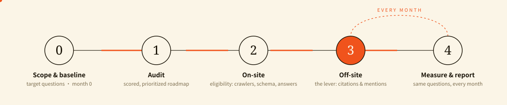

# geo-engine

<p align="center"></p>

<p align="center">


</p>

**The method for getting a brand named by AI answer engines** — ChatGPT, Perplexity, Gemini and Google AI Overviews, Claude, Grok, and the Chinese engines (DeepSeek, Kimi, Qwen, Doubao, Yuanbao, Baidu). A complete, opinionated [Claude Code](https://claude.com/claude-code) skill for **Generative Engine Optimization (GEO / AEO)**, distilled from paid client work.

When someone asks an AI *"best bakery for birthday cakes in Richmond BC"* or *"how much is 60k after tax in Ontario"*, the answer names three or four businesses. There is no page two. GEO is the work that puts **your** name in that short list — and this repo is the playbook for doing it without guessing.

## Measure, then move

| | Repo | What it answers |
| --- | --- | --- |
| **Measure** | [does-ai-know-you](https://github.com/Hellotravisss/does-ai-know-you) | *Which engines name you today, and who do they name instead?* Asks 12 engines your customers' questions, saves every answer. |
| **Move** | **geo-engine** (this repo) | *What do I change so that number goes up?* The engagement, the audit rubric, the off-site playbook, the monthly report. |

Every recommendation in this skill assumes you measured first. A GEO plan without a baseline is a guess with a deadline.

## The one idea most "GEO checklists" miss

> **Off-site citations are the dominant lever — by far.** On-site work (schema, `llms.txt`, answer-first content) only makes you *eligible*. What moves AI recommendations is how many trusted places across the web cite or mention you: Reddit, "best-of" listicles, Wikidata, press, the platforms each engine actually reads. This skill leads with that, grades every recommendation by **evidence strength**, and never promises "guaranteed AI placement" — AI answers are non-deterministic and personalized.

## The engagement

<p align="center"></p>

| Phase | What it does |
|---|---|
| **0 · Scope & baseline** | Pick the archetype, fix the target questions, record where every engine stands today (month 0). Check for a **name collision** first. |
| **1 · Audit** | Score the site and the entity against the leverage hierarchy → a prioritized roadmap. Record each engine as **absent / correct / wrong** — a confidently *wrong* description is the most urgent finding. |
| **2 · On-site** | Crawler access (per-bot, including the auth gate most people forget), Bing + IndexNow on day one, structured data, answer-first content, original-data pages. |
| **3 · Off-site** | The real lever: community answers, original-data outreach, listicles, Wikidata, and the platform traps that get accounts banned. |
| **4 · Measure & report** | Same questions, same engines, every month. Mention rate, link rate, share of voice — and AI-referral traffic reported honestly as a floor, never a total. |

## What's inside

**`.claude/skills/geo-engine/`** — the skill: `SKILL.md` plus eight references.

| File | Use it for |
| --- | --- |
| `archetypes.md` | Map a brand to its playbook: local service, data/tool, SaaS, ecommerce, publisher, directory, personal brand. Two worked case studies. |
| `audit-rubric.md` | The scored audit, including a per-bot crawler check (`OAI-SearchBot`, `Claude-SearchBot`, `PerplexityBot`…). |
| `onsite-sop.md` | Crawler access, `llms.txt` (and why it's last), answer-first copy, Bing/IndexNow, Google preferred sources. |
| `schema-library.md` | Copy-paste JSON-LD per archetype — and why `address` and `areaServed` must never be collapsed. |
| `offsite-sop.md` | Community, outreach and entity work, plus the platform rules that turn a listing into a ban. |
| `measurement.md` | The prompt set, sampling, the monthly AI-Visibility Report template. |
| `i18n.md` | Bilingual and Chinese-engine GEO: which platforms each engine reads, and why the bilingual gap is the strongest opening you have. |
| `operator-playbook.md` | What the consultant must ask the client for **on day one**, how to explain GEO to an owner who knows SEO, and the outreach law (CASL) that caps at $1M per violation. |

**`examples/geo-auditor-agent/`** — turns the method into a running [Claude Managed Agent](https://platform.claude.com/docs/en/managed-agents/overview): hand it a URL, it audits the live site and writes a scored report and roadmap. A real sample output is in `evals/case-01/expected.md`.

## Install

```bash
git clone https://github.com/Hellotravisss/geo-engine
cp -R geo-engine/.claude/skills/geo-engine ~/.claude/skills/
```

Then in Claude Code, run **`/geo-engine`**, or just ask *"do GEO on example.com"*. It scopes, measures, audits and implements against the method above.

### Run it as an autonomous auditor (optional)

```bash
cd examples/geo-auditor-agent
cp .env.example .env          # add your ANTHROPIC_API_KEY
bash launch.sh                # environment → agent → session → audit kickoff
bash poll.sh && bash fetch.sh # watch, then download the report
```

## Case studies

- **CanPay Insights** ([canpayinsights.ca](https://canpayinsights.ca)) — *data/tool* archetype. A free Canadian take-home-pay calculator. The off-site and original-data playbook came from here.
- **Travis Zhang Photography** ([traviszhang.com](https://traviszhang.com)) — *service/local* archetype. A Vancouver architectural photographer. The on-site and entity playbook came from here.
- **SAVORHILL 山也** ([savorhill.ca](https://savorhill.ca)) — a bilingual bakery. Its October 2026 measurement across 11 engines is published, with the owner's permission, in [does-ai-know-you](https://github.com/Hellotravisss/does-ai-know-you#a-real-result).

> **Honest note:** GEO compounds over weeks to months. These show the method *applied*; AI visibility is tracked over time and never guaranteed.

## Built by

**Travis Zhang (Qi Zhang)** · [Avowd 青眼](https://avowd.ai) — measures brands across 12 AI engines, Western and Chinese, every month, and does the work that moves the numbers. How we measure: [avowd.ai/method](https://avowd.ai/method).

GEO audits, implementation and monthly retainers: **info@avowd.ai**

## License

[MIT](LICENSE) — use it, fork it, sell services with it.
